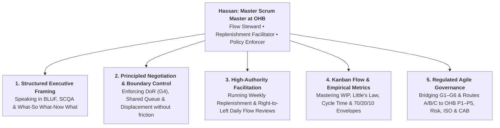

# The Commanding Scrum Master: Skills, Charisma & Mental Models Playbook

**Prepared for**: Hassan Al-Maqbali, Agile Project Manager / Scrum Master at OHB  
**Context**: Leading OHB's Proposed Controlled Scrumban Operating Model (`P1–P5` & `G1–G6`) with Executive Presence, Authority, and Respect

---

## Executive Summary (BLUF)

**Bottom Line Up Front**: You already have strong English language skills and deep knowledge of OHB's governance. The reason you feel communication is your lowest skill—and the reason you want stronger charisma and respect—is **not** a language problem. It is a **structural framing and authority problem**.

In a banking environment like OHB, senior stakeholders (ExCom, MSSC, Sponsors, and vocal Business Leads) do not respect people who speak *more* or explain *politely*. They respect leaders who speak in **headlines, trade-offs, and system physics**. Under the new Controlled Scrumban framework, you are no longer a traditional project coordinator chasing updates—you are the **Flow Steward and Neutral Replenishment Gatekeeper** of a shared engineering engine.

This playbook breaks down:
1. **The 5 Core Skills** required to dominate your Scrum Master role in OHB's Scrumban workflow.
2. **The Anatomy of Charisma & Respect** (how to shift from "polite PM" to "commanding advisor").
3. **The 7 Mental Models** to run in your head before walking into any OHB meeting.
4. **Curated World-Class Learning Links** (YouTube, Podcasts, Coursera, LinkedIn Learning, and Books) mapped to each skill.
5. **A 4-Week Daily Practice Regimen** to rewire your communication reflexes.

---

## Part 1: Why "Good Language" ≠ Commanding Communication

Many smart Project Managers fall into the **"Chronological Explainer Trap"**:
* When asked a tough question in a meeting, they start from the beginning of the story, explain all the technical background, use polite softening words (*"I think," "just," "maybe," "we tried"*), and finally arrive at the conclusion 90 seconds later.
* **What happens in the room**: By second 20, the Sponsor or Business Lead has lost patience, interrupts you, and takes control of the room.

### The Formula for Executive Charisma & Respect
According to executive presence research (including Olivia Fox Cabane's *The Charisma Myth* and Stanford GSB's communication lab), workplace charisma and respect come from combining three signals:

$$\text{Commanding Presence} = \text{Unshakeable Composure} + \text{Structured Brevity (BLUF)} + \text{Process Neutrality}$$

| Signal | "Polite Coordinator" Behavior (Low Respect) | "Commanding Scrum Master" Behavior (High Respect) |
| :--- | :--- | :--- |
| **Opening a Point** | Gives 2 minutes of backstory before stating the ask. | **Vocal BLUF**: States the conclusion/decision needed in Sentence 1, then pauses. |
| **Handling Pushback** | Takes it personally, gets defensive, or caves in (*"Okay, we'll try to squeeze it in"*). | **Process Neutral**: Never argues opinions. Points calmly to the **6-Step Policy Stack** and capacity math. |
| **Pacing & Silence** | Rushes to fill silence; speaks faster when challenged. | **The 2-Second Pause**: Pauses for 2 full seconds after being challenged, nods slowly, and speaks 15% slower. |
| **Word Choice** | Uses hedge words: *"Sorry, I just wanted to check if maybe we can..."* | Uses clean authority: *"Looking at our Ready Queue WIP, we have two options today..."* |
| **Body & Visual Anchor** | Looks nervously from person to person seeking approval. | Anchors the room's eyes on the **Shared Ready Queue / Flow Metrics** on screen. |

---

## Part 2: The 5 Core Skills You Need in OHB's Scrumban Workflow

In the OHB Controlled Scrumban presentation, Slide 12 and Slide 20 define your role as **Flow Steward, Replenishment Facilitator, and Policy Enforcer**. Here are the exact 5 skills required to master that seat:

### 1. Structured Executive Framing (Spontaneous Speaking Under Pressure)
* **Where you need it**: Quarterly Planning (Gate G3), Agile Management Group escalations, Sprint Reviews, and answering sudden Sponsor questions.
* **What mastery looks like**: You never ramble. Even when ambushed with an unexpected question, you immediately package your answer into a 3-part mental container (e.g., *Answer → 2 Supporting Facts → Recommended Decision*).

### 2. Principled Negotiation & Boundary Enforcement ("The Velvet Hammer")
* **Where you need it**: Chairing **Weekly Backlog Replenishment** (Slide 12) where multiple Product Owners compete for the same developers, and blocking mid-Sprint "VIP shoulder-taps."
* **What mastery looks like**: You can tell a senior Business Lead *"This cannot enter the Sprint today"* in a way that makes them feel respected, heard, and guided—using **Step 1 (Authorized) vs. Step 2 (Ready)** and **Step 6 (Displacement)**.

### 3. High-Authority Meeting Facilitation & Room Control
* **Where you need it**: Running all **7 Scrumban Ceremonies** (Slide 17).
* **What mastery looks like**: You open every meeting by stating the **Decision Purpose** in 30 seconds. When two stakeholders argue in circles, you cut in smoothly, park tangents, and force a trade-off decision before the clock runs out.

### 4. Kanban Flow Physics & Empirical Forecasting
* **Where you need it**: Managing the **8-Column Board** (Slide 18), **70/20/10 Capacity Envelopes** (Slide 15), **6 Service Classes** (Slide 19), and **System Health Metrics** (Slide 21).
* **What mastery looks like**: You understand **Little's Law**, **Work-Item Age**, **Cycle-Time Percentiles**, and **Blocked-Time Ratio** so deeply that when someone asks *"Why can't developers just start all 15 stories now?"*, you can prove mathematically why starting more work delays completion.

### 5. Banking Control & Psychological Safety Stewardship
* **Where you need it**: Protecting the engineering team from toxic metrics (banning individual velocity/LoC per Slide 21) while assuring Risk, ISO, CAB, and Internal Audit that **Gates G1–G6** and **Routes A/B/C** remediate Audit Findings **F12**, **F15**, and **F17**.

---

## Part 3: The 7 Mental Models for Entering Any Meeting with Power

Before you walk into any conference room or join any Teams call at OHB, pick the mental model below that fits the room. Having a mental model means **you already know the structure of the conversation before anyone speaks**.

---

### Mental Model 1: The "Air Traffic Controller" Frame (Process Neutrality)
> **Use when**: Chairing Weekly Backlog Replenishment or facing a pushy Product Owner.

* **The Mindset**: An Air Traffic Controller does not decide which airline's VIP passengers are more important—and if an airline executive yells at the tower to land two planes on the same runway at the same time, the controller doesn't get emotional. They calmly state runway physics: *"Runway 1 has a WIP limit of 1 aircraft. If Flight B lands now, Flight A must circle for 20 minutes."*
* **How it gives you respect**: Most PMs lose respect because they get dragged into arguing *business opinions* with Business Leads. Under Slide 12 & 20, **you do not own business priority—you own the runway rules (the 6-Step Policy Stack)**.
* **Your Power Line in the Room**:
  > *"I don't decide which feature is more valuable to the bank—that's your authority as Product Owners and the Agile Management Group's call. My job is to protect the runway so whatever enters the Shared Ready Queue actually finishes. Right now we have 3 open slots—let's run the Policy Stack."*

---

### Mental Model 2: "What? → So What? → Now What?" (The Instant Clarity Loop)
> **Use when**: Put on the spot in any meeting, status review, or hallway conversation.

Whenever anyone asks you for an update or challenges you unexpectedly, force your mouth to speak in three bullet steps—and then stop talking:
1. **WHAT (The Fact / Metric)**: State the objective reality or metric in one sentence.
2. **SO WHAT (The Business Impact)**: State what that means for the Sprint Goal, Quarter Commitment, or Gate.
3. **NOW WHAT (The Decision / Action)**: State the exact action being taken or the option the stakeholder must choose.

* **Example at OHB**:
  * ❌ *Weak response*: *"Well, the testers found several issues in Product A's UAT this week and the developers have been spending a lot of time answering their questions on Teams, so we haven't made as much progress on Product B's stories as we hoped..."*
  * ✅ *Commanding response (What → So What → Now What)*:
    > **"[WHAT]** UAT support on Product A consumed 35% of team capacity this week against our planned 20% envelope.  
    > **[SO WHAT]** That leaves 15% less capacity for Product B's Stretch MVP stories this Sprint, though our Committed Goal remains safe.  
    > **[NOW WHAT]** At Thursday's Replenishment, we will either queue low-severity UAT defects into next Sprint's Standard queue or defer one Stretch story. Which do you prefer?"

---

### Mental Model 3: SCQA (Situation → Complication → Question → Answer)
> **Use when**: Opening a Steering Committee (MSSC), Agile Management Group briefing, or Escalation.

Developed by Barbara Minto at McKinsey, SCQA hooks executive brains immediately because it mirrors how decision-makers think:
* **S — Situation (Uncontroversial fact)**: *"At Gate G3 Quarterly Planning, we locked the Digital Onboarding MVP as a Committed Goal with a 70% feature capacity envelope."*
* **C — Complication (The trigger/tension)**: *"Today, a new CBO regulatory reporting change arrived with an immovable Fixed Date next month."*
* **Q — Question (The core trade-off)**: *"How do we absorb this Fixed-Date regulatory work without breaking our WIP limits or surprising MSSC at the end of the quarter?"*
* **A — Answer (Your BLUF recommendation)**: *"We classify the CBO change as a Fixed-Date Service Class item and displace two Stretch MVP stories into next quarter, keeping our Mandatory MVP Go-Live intact."*

---

### Mental Model 4: "Yes, And Here Is the Price Tag" (The Trade-Off Mirror)
> **Use when**: A Sponsor, GM, or Product Owner demands scope additions or urgent mid-Sprint injections.

* **The Mindset**: Weak PMs say *"Yes, we'll try our best"* (and then fail at the end of the Sprint). Rigid PMs say *"No, that's against Agile rules"* (and get labeled obstructive). A Master Scrum Master holds up a **Trade-Off Mirror** (Slide 9 & Slide 13 Step 6: Displacement).
* **Your Rule**: You never say "No" to a senior stakeholder. You say **"Yes, and let's choose which trade-off pays for it."**
* **Your Power Line in the Room**:
  > *"We can absolutely prioritize that. Under our framework's trade-off rule, adding this 5-day feature today requires one of three choices: (A) Displace Story X from the Ready Queue, (B) Draw down our Stretch MVP buffer, or (C) Revise the quarterly forecast date by 1 week. Which option works best for the business?"*

---

### Mental Model 5: The Two-Key Launch System ("Authorized ≠ Ready")
> **Use when**: A senior stakeholder uses their rank to push a vague, half-baked idea straight into development.

* **The Mindset**: Imagine a nuclear submarine or bank vault that requires **two separate keys** turned simultaneously to open:
  * **Key 1 — AUTHORIZED (Management / PO Key)**: Does OHB want this built and allow it to consume budget/capacity?
  * **Key 2 — READY (Scrum Master / Engineering Gate G4 Key)**: Are the acceptance criteria testable, dependencies cleared, environments ready, and story sized `Small/Medium`?
* **How it gives you respect**: You validate their seniority by acknowledging Key 1 immediately—then firmly hold Key 2 until Definition of Ready is met.
* **Your Power Line in the Room**:
  > *"Your authority turns Key 1—this item is 100% Authorized. My accountability as Scrum Master is Key 2—ensuring the team has testable acceptance criteria and test data (Gate G4) so they don't stall on Day 2. Let's spend 48 hours in Refinement turning Key 2, or run a time-boxed Spike first."*

---

### Mental Model 6: Little's Law & Highway Physics ("Stop Starting, Start Finishing")
> **Use when**: Stakeholders or developers push to start 10 things at once so every PO feels "progress is happening."

* **The Mindset**: Think of the Sheikh Sultan Bin Qaboos Highway at rush hour. When 100% of the pavement is packed with cars (100% utilization / high WIP), traffic speed drops to zero. In flow physics (**Little's Law**):
  $$\text{Average Cycle Time} = \frac{\text{Work In Progress (WIP)}}{\text{Throughput}}$$
  If your team completes 5 stories a week (Throughput = 5), and you let POs push 15 stories into Active Dev (WIP = 15), the average story takes **3 weeks** to finish. If you cap WIP at 5 stories, the average story finishes in **1 week**!
* **Your Power Line in the Room**:
  > *"Starting your story today when 8 stories are already half-done won't make it finish sooner—it just puts your story in a traffic jam. By capping WIP and finishing what's in Code Review and UAT first, your story will actually reach production faster."*

---

### Mental Model 7: The Stakeholder Incentive & Fear X-Ray
> **Use when**: Walking into a tense room where people are resisting the new framework or fighting over priorities.

Before you speak a single word in a meeting, look around the table and mentally label each person's **Hidden Fear**:
* **The Sponsor**: Fears looking uninformed or missing a promised target in front of the CEO/MSSC. *(Give them predictability & early warning).*
* **The Product Owner (BL)**: Fears their department's project being starved of developer time while another PO hogs the team. *(Give them transparent Weekly Replenishment & Cross-Product Change protection).*
* **The Tech Lead / Developer**: Fears being blamed for delays caused by vague requirements, UAT interruptions, and tech debt. *(Give them Gate G4 DoR protection, 20% UAT + 10% Ops envelopes, and ban individual velocity ranking).*
* **Risk / ISO / Internal Audit**: Fears an unapproved change causing a security/CBO incident with their name on it. *(Give them Controls by Design, Maker-Checker in Col 3, and Gate G6 CAB evidence).*

---

## Part 4: Curated Learning Library (With Direct Links)

Here are the highest-signal resources in the world mapped directly to your goals: **Executive Communication, Charisma & Presence, Principled Negotiation, and Scrumban/Kanban Mastery**.

### 1. Mastering Spontaneous Speaking, Structure & Charisma (Your #1 Priority)

| Type | Resource & Link | Why It Is Essential for Hassan |
| :--- | :--- | :--- |
| **YouTube & Podcast** | [**Think Fast, Talk Smart** — Matt Abrahams (Stanford GSB)](https://www.youtube.com/@stanfordsbusiness) / [Podcast Page](https://www.gsb.stanford.edu/business-podcasts/think-fast-talk-smart-podcast) / [Famous 55-Min Stanford Talk on YouTube](https://www.youtube.com/watch?v=HAnw168huqA) | **Start here today.** Watch Matt Abrahams' viral Stanford lecture *"Think Fast, Talk Smart: Communication Techniques"* (40M+ views). It teaches the exact mental frameworks (*What → So What → Now What*) for speaking off-the-cuff under pressure without rambling. |
| **YouTube Channel** | [**Charisma on Command**](https://www.youtube.com/@Charismaoncommand) | Breaks down video clips of world leaders and executives frame-by-frame: how to hold eye contact, pause before answering, project vocal weight, and handle interruptions without losing composure. |
| **Book** | ***The Charisma Myth*** by Olivia Fox Cabane — [Overview & Summary Talk at Google (YouTube)](https://www.youtube.com/watch?v=LMu_md_5PQ4) | Demystifies charisma as a set of learnable behaviors (**Presence + Power + Warmth**). Teaches how to project authority in high-stakes corporate rooms without sounding aggressive. |
| **Book** | ***The Pyramid Principle*** by Barbara Minto — [Executive Summary Guide](https://www.Goodreads.com/book/show/388915.The_Pyramid_Principle) | The gold standard used by McKinsey & BCG for top-down communication (BLUF, SCQA, and grouping arguments into 3s so executives immediately trust your logic). |
| **Coursera** | [**Strategic Communication for Sustainability Leaders / Executive Presence** (University of Maryland / Coursera Executive Presence Search)](https://www.coursera.org/courses?query=executive%20presence%20communication) & [**Dynamic Public Speaking Specialization** (Univ. of Washington)](https://www.coursera.org/specializations/public-speaking) | Structured academic practice on vocal delivery, persuasive framing, and executive gravitas. |
| **LinkedIn Learning** | [**Communicating with Confidence** — Jeff Ansell](https://www.linkedin.com/learning/communicating-with-confidence) & [**Executive Presence on Video Conference Calls** — Jessica Chen](https://www.linkedin.com/learning/executive-presence-on-video-conference-calls) | Short, tactical modules on eliminating filler words, speaking with downward inflection, and commanding physical and virtual rooms. |

---

### 2. Mastering Principled Pushback, Negotiation & Stakeholder Respect

| Type | Resource & Link | Why It Is Essential for Hassan |
| :--- | :--- | :--- |
| **Book & YouTube** | ***Never Split the Difference*** by Chris Voss (Former FBI Lead Hostage Negotiator) — [Talks at Google (YouTube)](https://www.youtube.com/watch?v=guZa7mQV1l0) | Teaches **Tactical Empathy**, **Labeling** (*"It sounds like you're under massive pressure to deliver this for the GM..."*), and **Calibrated Questions** (*"How am I supposed to pull this today without displacing our Committed Q1 goal?"*). Game-changing for handling pushy POs. |
| **Book & YouTube** | ***Crucial Conversations: Tools for Talking When Stakes Are High*** — [Joseph Grenny Keynote (YouTube)](https://www.youtube.com/watch?v=9K8W4o7g0bU) | Teaches how to stay in dialogue when senior stakeholders get emotional, defensive, or political—and how to create Mutual Purpose before pushing back on scope. |
| **Book & YouTube** | ***Turn the Ship Around!*** by L. David Marquet — [Animated Leadership Talk (YouTube)](https://www.youtube.com/watch?v=OqmdLcyES_Q) | How a US Navy submarine captain replaced "permission-based leadership" with **"Intent-Based Leadership."** Essential for shifting OHB's developers and POs into true ownership. |
| **LinkedIn Learning** | [**Influencing Without Authority** — Dorie Clark /INK](https://www.linkedin.com/learning/search?keywords=influencing%20without%20authority) | Directly targets the #1 challenge of a Scrum Master/PM: how to drive compliance and decisions across people who do not report to you. |

---

### 3. Mastering Scrumban, Kanban Flow Physics & Empirical Forecasting

| Type | Resource & Link | Why It Is Essential for Hassan |
| :--- | :--- | :--- |
| **YouTube & Podcast** | [**Drunk Agile** — Daniel Vacanti & Prateek Singh (YouTube)](https://www.youtube.com/@DrunkAgile) | **The #1 resource for OHB's exact model.** Daniel Vacanti co-created the *Kanban Guide for Scrum Teams (ProKanban)*. Their episodes explain WIP limits, Work-Item Age, Right-to-Left daily standups, Service Classes, and why story points fail compared to Throughput/Cycle Time. |
| **Book (Free/Core)** | [**The Official Kanban Guide for Scrum Teams** (Scrum.org & ProKanban.org — Free PDF)](https://www.scrum.org/resources/kanban-guide-scrum-teams) & [**The Kanban Guide** (kanban.university / prokanban.org)](https://prokanban.org/the-kanban-guide/) | Short, 15-page authoritative guides defining the exact flow metrics in Slide 21 of your OHB presentation (**Throughput, Cycle Time, Work-Item Age, WIP**). |
| **Book** | ***Actionable Agile Metrics for Predictability*** by Daniel S. Vacanti — [Book Reference](https://www.actionableagile.com/books/) | The bible behind Slide 14 (*"Estimate informs forecast; forecast informs commitment"*) and Slide 21. Read this and no one at OHB will ever match your mastery of flow metrics. |
| **Book** | ***Making Work Visible: Exposing Time Theft to Optimize Work & Flow*** by Dominica DeGrandis — [IT Revolution Talk (YouTube)](https://www.youtube.com/watch?v=R8wA2tbfWWs) | Explains the **5 Thieves of Time** (Too much WIP, Unknown Dependencies, Unplanned Work, Conflicting Priorities, Neglected Work)—which is the exact foundation of OHB's 70/20/10 capacity envelopes and Shared Ready Queue! |
| **Coursera** | [**Agile with Atlassian Jira** (Atlassian on Coursera)](https://www.coursera.org/learn/agile-atlassian-jira) | Hands-on mastery of configuring Scrum + Kanban (Scrumban) boards, WIP limits, swimlanes by Service Class, and cumulative flow diagrams. |

---

## Part 5: Your 4-Week Transformation Plan (From Knowledge to Reflex)

Do not try to watch 20 hours of videos at once. Charisma and authority are **muscle memory** built through small daily drills at OHB:

### Week 1: The "Vocal BLUF & 2-Second Pause" Drill
* **Watch**: Matt Abrahams' [Think Fast, Talk Smart talk on YouTube](https://www.youtube.com/watch?v=HAnw168huqA) (55 mins).
* **Daily Habit at OHB**:
  1. In every meeting this week, **force a 2-second silent pause** before you answer any question.
  2. Answer every question using **What → So What → Now What** in under 45 seconds, then stop talking.
  3. Delete the words *"just," "sorry," "maybe,"* and *"I think"* from your emails and speech.

### Week 2: The "Air Traffic Controller" Boundary Drill
* **Watch**: Chris Voss's [Never Split the Difference talk at Google](https://www.youtube.com/watch?v=guZa7mQV1l0) + Dominica DeGrandis's [Making Work Visible talk](https://www.youtube.com/watch?v=R8wA2tbfWWs).
* **Daily Habit at OHB**:
  1. Practice using the **Two-Key System** (*"Authorized vs. Ready"*) and the **Trade-Off Mirror** (*"Yes, and which item do we displace?"*) whenever a stakeholder asks for an unplanned addition.
  2. Never say *"I feel"* or *"In my opinion"* when discussing priorities—always point to the **Policy Stack** or **Capacity Envelope**.

### Week 3: The "Right-to-Left Flow & Metrics" Drill
* **Read/Watch**: [The Kanban Guide for Scrum Teams](https://www.scrum.org/resources/kanban-guide-scrum-teams) + 3 episodes of [Drunk Agile on Work-Item Age & Daily Standups](https://www.youtube.com/@DrunkAgile).
* **Daily Habit at OHB**:
  1. Practice running a 15-minute review walking a board **Right-to-Left** (`Release Ready ← UAT ← PO Validation ← Test ← Code Review ← Dev`).
  2. Call out **Work-Item Age** (*"This item has been in Code Review for 4 days—what do we need to move it today before starting anything new?"*).

### Week 4: High-Stakes Executive Simulation
* **Practice with me (PM Assistant)**: Before your first real presentation to the Head of PMO, MSSC, or Product Owners, run a live **15-minute roleplay simulation** right here (or use `/grill-me`) where I play a tough OHB Sponsor or aggressive Business Lead trying to break your queue rules, and I grade your answers on **BLUF structure, brevity, and charisma**.

---

> 💡 **Strategic Observation**:  
> Here is a secret about corporate psychology at banks like OHB: **People take you as seriously as you take your own boundaries.** Why do Business Leads respect CAB or Central Bank of Oman (CBO) deadlines, yet routinely push Project Managers around? Because CAB has non-negotiable entry criteria—if your change ticket doesn't have a rollback plan and UAT sign-off, CAB doesn't argue with you for 30 minutes; they calmly say *"Ticket held until criteria are met."* The moment you run **Weekly Backlog Replenishment** and **Gate G4 (Definition of Ready)** with that exact same warm, unemotional certainty, the entire bank's perception of you changes overnight. You stop being "Hassan the PM we can pressure" and become "Hassan, the steward of OHB's delivery engine."
